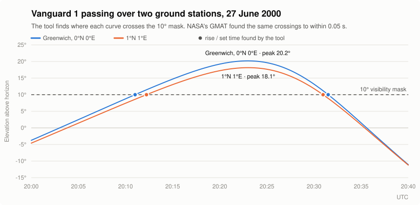

# Spacecraft Mission Analysis — Ground-Station Access and Coverage

**Engineering question:** Given archived satellite orbit data, fixed ground
stations and an analysis period, when is a spacecraft geometrically visible
from each station, and what proportion of the period has visibility from at
least one station?

**Delivered:** A reproducible Python command-line tool (v0.1.0) that calculates
satellite access windows, combines overlapping windows across stations and
exports versioned JSON/CSV results. The engineering scope is deliberately
bounded: this is an analysis of **geometric visibility**, not proof that a
radio link will work or an operational pass-prediction service.

<picture>
  <source media="(prefers-color-scheme: dark)" srcset="docs/figures/vanguard_pass_dark.svg">
  
</picture>

The figure comes from the [production calculation and saved example](examples/vanguard_run/);
the [figure script](docs/figures/make_vanguard_pass_figure.py) reproduces it.

## Result and evidence at a glance

| Review check | Recorded result | Pre-set acceptance limit |
| --- | ---: | ---: |
| Rise/set timing against NASA GMAT R2026a (same imported trajectory, two stations) | max **0.0505 s** difference | 0.25 s |
| Rise/set timing against Skyfield (24 h held-out case) | max **0.0019 s** difference | 0.020 s |
| Elevation against Skyfield (319 sampled times in held-out case) | max **1.1 × 10⁻¹²°** difference | 1 × 10⁻⁹° |
| Automated tests in CI | **203** | — |
| Archived example after a same-environment clean reinstall | **7/7 output files byte-identical** | — |

These are **software comparison results**, not measured real-world pass
accuracy. Skyfield and this tool use the same underlying SGP4 library, so that
comparison does **not** independently validate orbit propagation. The GMAT
event comparison imported this tool's trajectory, so it checks the downstream
access calculation rather than independent orbital accuracy. Detailed evidence
and the distinct cross-model GMAT diagnostic are in the
[validation record](docs/validation.md).

### Worked case: archived Vanguard 1

The [saved example](examples/vanguard_run/) analyses Vanguard 1 on
27 June 2000 from **20:00 to 20:40 UTC** with a **10° minimum elevation** and
two **synthetic** stations (0°N, 0°E and 1°N, 1°E). Both stations detect an
access window. Combining them gives **1,229.268 seconds of geometric access,
or 51.22% of the 40-minute period**. The full event timestamps, inputs and
outputs are in [run.json](examples/vanguard_run/run.json).

To make this archived calculation reproducible, the example uses an explicit,
hashed **test-only zero Earth-orientation table**. That is a numerical
reproducibility fixture, **not** the physical Earth orientation on that date.
The output is therefore not evidence of an actual historical radio contact.

## How the analysis works

```text
archived TLE orbit data
    → SGP4 satellite position/velocity in TEME
    → Astropy transform to Earth-fixed ITRS coordinates
    → WGS84 ground-station position and local East/North/Up geometry
    → satellite elevation relative to each station's visibility threshold
    → coarse crossing search + Brent root refinement for rise/set times
    → access windows for each station
    → merged windows, coverage fraction and longest no-access gap
    → versioned JSON and six CSV files
```

The tool uses a **5-second search grid** to discover potential crossings of
the station's elevation threshold, then refines bracketed crossing times
numerically. This separates event discovery from precise event timing, but it
also creates a real limitation: a very short near-grazing pass can be missed
between grid samples. The [architecture](docs/architecture.md) describes the
interfaces, time handling and coordinate-frame choices.

## What was checked — and what changed when checks failed

- **Component and analytical checks:** published SGP4 reference vectors,
  independently evaluated frame equations, ground-station geometry, analytic
  crossing and peak cases, and hand-calculated coverage examples. The original
  published-frame comparison exceeded one fixed position limit by **3.17 mm**;
  that failure remains recorded alongside the [matched-time investigation](docs/decisions/0001-matched-split-ut1-frame-reference.md).
- **Cross-implementation checks:** a frozen Skyfield hold-out and a GMAT
  comparison of event times on an imported trajectory. Their results are
  reported only within the independence and modelling boundaries above.
- **A validation-method failure:** early GMAT state-transfer checks failed.
  Investigation found that an original velocity-equality gate assumed behaviour
  GMAT's documented interpolation did not guarantee. The failed gate was
  retained; [Decision 0004](docs/decisions/0004-gmat-stk-position-transfer-gate.md)
  records a revised, predeclared continuous-time **position** check, which
  passed before the bounded GMAT event comparison was accepted.
- **Reproducibility and failure handling:** explicit input/Earth-orientation
  provenance, structured failures, saved output and automated checks, with
  known discrepancies and dispositions in the [issue register](docs/issues.md).

This evidence supports a **reviewable v0.1.0 release**, not a claim that every
model assumption or failure mode has been validated. The
[release case](docs/release-v0.1.0.md), [requirements](docs/requirements.md),
[verification record](docs/verification.md) and
[validation record](docs/validation.md) distinguish verified behaviour,
partially validated behaviour and open limitations.

## Engineering boundaries

The output represents geometric line-of-sight above an elevation threshold.
It excludes refraction, link budgets, antenna constraints, eclipse, sensor
footprints and operational scheduling. Archived TLE age and Earth-orientation
inputs affect the result; physical pass-time uncertainty is **not quantified**.
Finite-step event discovery can miss short access, and bounded peak searching
cannot guarantee the highest possible unsampled peak. Independent
same-model SGP4 propagation validation remains open. The software is **not
operational, certified or flight-qualified**.

## Development approach and AI assistance

I defined the problem, requirements, modelling boundaries, acceptance criteria
and verification/validation approach. I used AI coding agents (Claude Code and
Codex) extensively to generate implementation code, tests and documentation.

The engineering aim was not simply to produce working code, but to establish
**which claims the available evidence actually supports**. Automated tests,
analytical cases and comparison tools were used to challenge the outputs;
failed checks and their dispositions remain available for review in the
[issue register](docs/issues.md) and
[engineering decisions](docs/decisions/README.md). AI-generated code is not
treated as evidence of correctness on its own.

## Reproduce the archived case

Python **3.11+** is required; dependencies are pinned in
[pyproject.toml](pyproject.toml). From the repository root:

```bash
python -m pip install .
spacecraft-mission-analysis examples/vanguard_run/config.json --output-dir output/vanguard
```

Expected: exit code `0`, `SUCCESS`, two station windows, one merged
interval, `run.json` and six CSV files under `output/vanguard/csv/`.
The command does not overwrite existing analysis files; use a fresh output
directory when rerunning. See the [archived example](examples/vanguard_run/README.md)
for inputs, hashes and reproduction details, and the
[input](docs/input-schema-v1.md) and [output](docs/run-schema-v1.md) contracts
for schemas and failure behaviour.

**Review links:** [v0.1.0 release decision](docs/release-v0.1.0.md) ·
[assumptions](docs/assumptions.md) · [architecture](docs/architecture.md) ·
[verification](docs/verification.md) · [validation](docs/validation.md) ·
[issues](docs/issues.md) · [decisions](docs/decisions/README.md).
